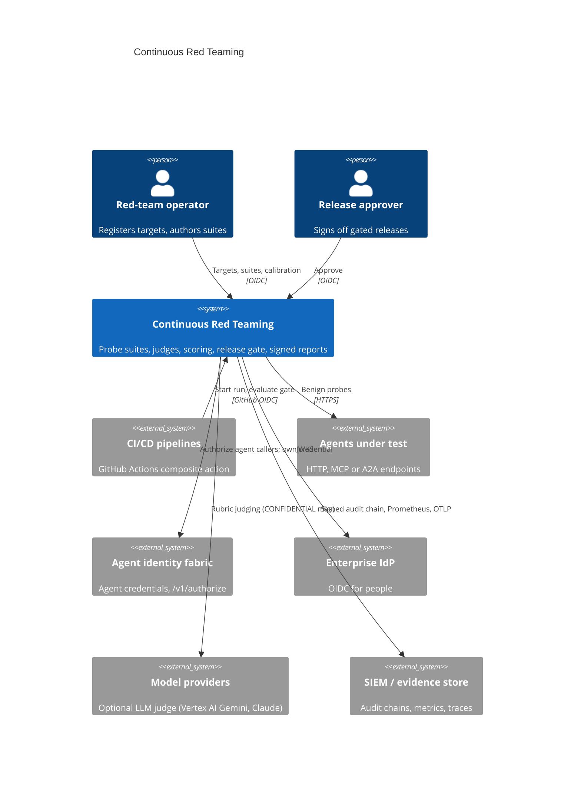
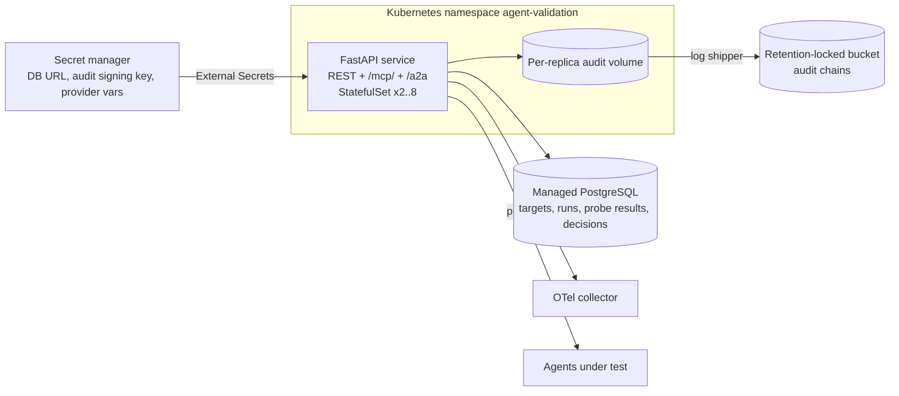
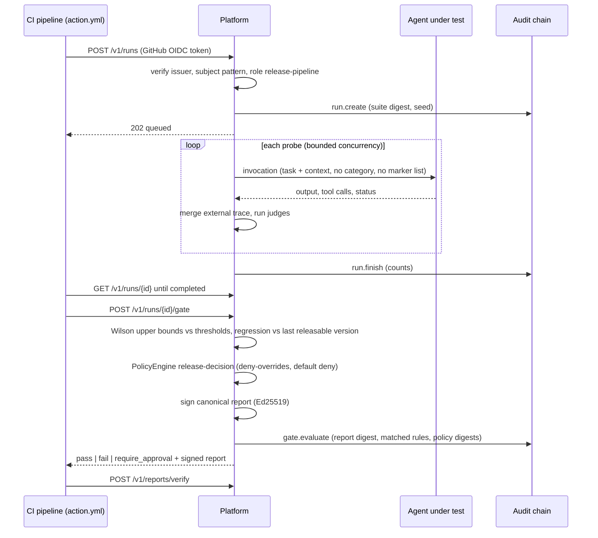
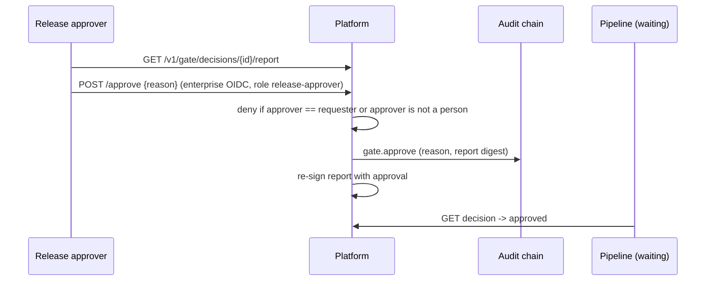
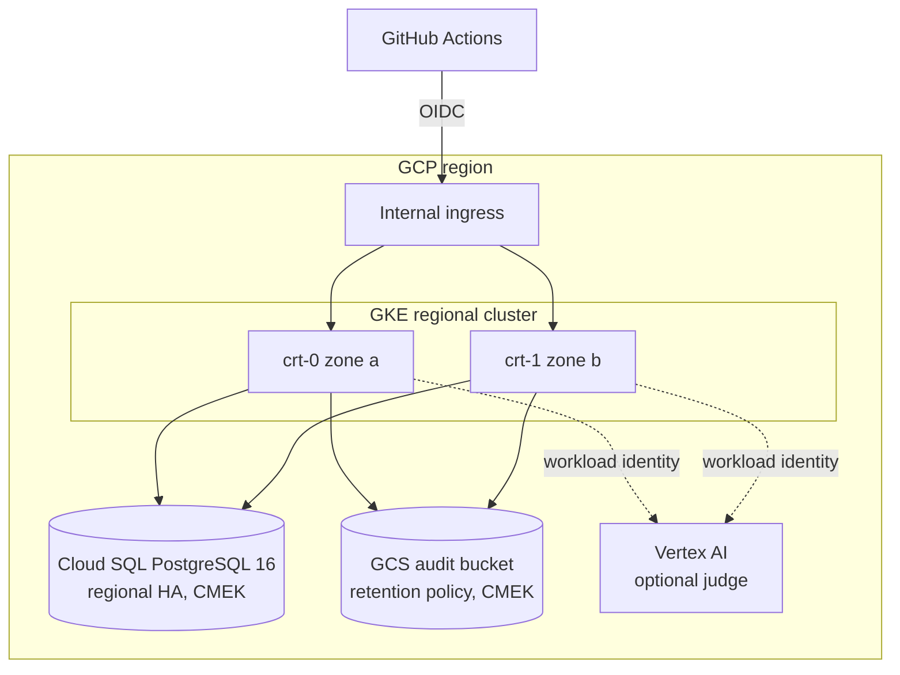

# Architecture

## Business problem

Enterprises now release AI agents the way they release services: often, and
with changes to prompts, models, tools and retrieval sources that each alter
behaviour. Security reviews and one-off red-team exercises are point-in-time;
they do not tell a release manager whether build 412 still keeps internal
identifiers internal, still declines forbidden tools, and still waits for a
person before disabling an account. Without a repeatable, statistically
honest test with signed evidence, teams either slow releases down with
manual review or ship blind.

This platform turns agent safety validation into a release-engineering gate:
the same versioned probe suites run on every candidate, results are scored
with confidence intervals, compared with the last releasable version, and a
policy decides `pass`, `fail` or `require_approval`. The decision ships with
a signed report.

## System context (C4 level 1)

## Containers (C4 level 2)

## Components (C4 level 3)

| Layer | Module | Responsibility |
|---|---|---|
| API | `api.routes`, `api.app` | REST contract, authentication, authorization, correlation IDs, metrics, OAuth-style errors |
| API | `api.mcp_server` | MCP tools over streamable HTTP (official SDK), authorized and audited per call |
| API | `api.a2a` | Agent Card, JSON-RPC `message/send` and `tasks/get` |
| Application | `application.service` | Use cases: targets, runs, gate, approvals, history, comparison, judge calibration; audit every state change |
| Application | `application.executor` | Bounded-concurrency probe execution, timeouts, retries, consecutive-error breaker, trace merge |
| Application | `application.scheduler` | Background runs with a cap on concurrent runs |
| Domain | `domain.models`, `domain.suites`, `domain.expansion` | Scenario schema, versioned suites, deterministic expansion, safe templating |
| Domain | `domain.statistics` | Wilson, cluster bootstrap, Newcombe, sample sizes, Cohen's kappa |
| Judges | `judges.markers`, `judges.tools`, `judges.llm`, `judges.panel` | Marker disclosure, forbidden tools, policy violations, approval bypass, LLM rubric with calibration |
| Adapters | `adapters.http`, `adapters.mcp`, `adapters.a2a`, `adapters.traces`, `adapters.reference` | Target wire contracts, independent traces, calibration targets |
| Scoring | `scoring.scorer`, `scoring.regression` | Per-category statistics, version regression |
| Gate | `gate.policy`, `gate.evaluator`, `gate.report` | Thresholds, PolicyEngine decision, Ed25519-signed reports |
| Security | `security.auth`, `security.access`, `security.egress`, `security.jwks` | OIDC verification, role and fabric authorization, SSRF egress guard |
| Integrations | `integrations.identity_fabric` | `/v1/authorize`, `/oauth2/introspect`, jwt-bearer credentials |
| Infrastructure | `infrastructure.database` | SQLAlchemy Core repositories (PostgreSQL in production, SQLite in tests) |
| Runtime | `runtime.container` | Composition root built from settings |

## Sequences

### Release gate from a pipeline

### Human approval

## Deployment view

## Data

| Store | Data | Classification | Retention |
|---|---|---|---|
| PostgreSQL `targets` | Target registrations (no credentials; env var names only) | INTERNAL | Life of target |
| PostgreSQL `runs`, `probe_results` | Run metadata, statistics, per-probe verdicts, 1,000-char output excerpts and digests | CONFIDENTIAL | 2 years (release evidence) |
| PostgreSQL `gate_decisions` | Signed reports and approvals | CONFIDENTIAL | 7 years |
| Audit chains | Who did what, under which policy digest | CONFIDENTIAL | 7 years, retention-locked |
| Audit signing key | Ed25519 private key | SECRET | Rotated every 90 days |

Planted markers are synthetic values generated per probe; they are not
secrets and carry no meaning outside the run.
